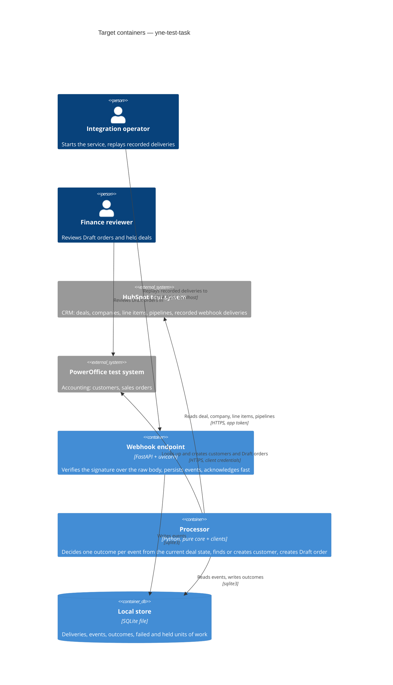

# Architecture map — yne-test-task

> The **target foundation** chosen in `survey` (greenfield). Nothing below exists as code yet;
> `scaffold` materializes it from `docs/features/_scaffold/tasks.json`. Read by specify / design /
> data-model / implement. Refresh with `survey` once code exists past `reflects_commit`.

## Stack

Decided with the owner on 2026-10-22; reasons in [ADR-0001](./adr/0001-use-python-fastapi-sqlite.md).

- Language / runtime: Python 3.14 (installed locally). Money is always `Decimal`, never `float`.
- Frameworks: FastAPI + uvicorn (webhook endpoint, boundary validation via its pydantic models,
  in-process `TestClient`); httpx (outbound HTTP clients; `httpx.MockTransport` for test fakes);
  `sqlite3` from the standard library (store).
- Tests: pytest. Lint and format: ruff (one tool). No other dependencies.
- Project file: `pyproject.toml` holds dependencies, the `dev` extra (pytest, ruff), and the
  pytest + ruff configuration. Exact versions are pinned at scaffold from what pip resolves.
- Commands:
  - install: `python -m pip install -e .[dev]` (inside a `.venv`)
  - check (the project's check command, CLAUDE.md rule 4): `ruff check . && pytest` — hermetic,
    no network, no containers.
- Existing Node tooling stays only for the Claude Code secrets hook (`.claude/hooks/*.mjs`);
  prettier is not used for Python.

## C4 — target baseline

How the processor is triggered (in the request, a background task, or a CLI command) is a design
decision (`/sdd:design`), not fixed here.

## Module inventory

Target layout (functional core, I/O at the edges — [ADR-0002](./adr/0002-separate-pure-core-from-io-edges.md)).
Concrete files inside each module are decided in design.

| Module | Path | Layers | Wired at | Responsibility |
|---|---|---|---|---|
| config | `app/config.py` | edge | `app/__main__.py` (planned) | Load and validate environment once; fail with missing variable names, never values |
| core | `app/core/` | pure domain | called by the processor | Won rule, orgnr normalization, hold rules, deal-to-order mapping, discount conversion. No I/O |
| clients | `app/clients/` | edge (boundary) | constructed in `app/__main__.py` (planned) | HubSpot and PowerOffice HTTP clients on `httpx.Client`: timeout on every call, retry only 429/5xx/network |
| store | `app/store.py` + `app/schema.sql` | edge | opened at startup | `sqlite3` access; schema applied at startup; unique key on event ID; one transaction per outcome |
| web | `app/web.py` | edge | `app/__main__.py` (planned) | FastAPI app: webhook endpoint, signature over the raw body |
| entry | `app/__main__.py` | edge | `python -m app` | Wires config, store, clients, web; CLI commands decided in design |
| tests | `tests/` | — | `pytest` | Unit tests for core; endpoint tests via `TestClient`; clients faked with `httpx.MockTransport` |

## Conventions (the rules a new feature must match)

No code exists yet, so nothing can be cited by `file:line`. These are the decided rules; `scaffold`
creates the first example of each, and the next `survey` refresh cites it.

- **Module wiring / registration:** plain constructor calls in `app/__main__.py`; no DI framework.
  Clients are passed into the processor as arguments so tests pass fakes.
- **Error handling:** blocking failures (config, auth, unreachable system) stop with a clear
  message. A failure in one unit of work is logged with its ID, recorded as failed, counted, and
  the run continues (CLAUDE.md "Errors").
- **IDs:** external IDs only — HubSpot event ID, deal ID; PowerOffice customer and order IDs. The
  order's external key is derived from the deal ID. No app-generated IDs.
- **Persistence / DB access:** `sqlite3` with plain SQL, no ORM; one connection per process; one
  transaction per recorded outcome ([ADR-0003](./adr/0003-use-sqlite-file-store-with-startup-schema.md)).
- **Migrations:** none. `app/schema.sql` uses `CREATE TABLE IF NOT EXISTS` and is applied at
  startup; a schema change during the assignment means deleting the local file.
- **Tests:** pytest under `tests/`, mirroring `app/` modules; synthetic fixtures shaped like
  `evidence/`; no outbound network; no `test:integration` / `e2e` targets.
- **Inter-module communication:** direct function calls. Core takes plain data and returns
  decisions; edges do the I/O.
- **Logging:** standard `logging`, structured key=value lines with delivery/event ID, counts,
  durations, statuses. Never personal values from the external systems.
- **Money and time:** `Decimal` for amounts and percentages; timestamps kept as received (epoch ms).
- **Sync over async:** sync `def` endpoints and `httpx.Client`; no async where it is not needed.

## Datastores

| Store | Engine | Accessed via | Notes |
|---|---|---|---|
| Local store | SQLite file (path from config, git-ignored) | `sqlite3` in `app/store.py` | Tables are decided in design/data-model. Production would use PostgreSQL + a managed queue with an outbox (known limitation, ADR-0003) |

## Frontend / UI foundation

<!-- N/A: no frontend -->

## Where things live / closest precedents

- A new pure rule (e.g. a hold reason) → `app/core/`, with a unit test in `tests/core/`.
- A new call to an external system → a method on the matching client in `app/clients/`, faked in
  tests with `httpx.MockTransport` and a synthetic fixture.
- No precedents exist yet; after scaffold, the smoke test is the first one.

## Constraints & known tech-debt

- Only the two test systems' hosts may be called (CLAUDE.md). Live runs are manual, by the human.
- Python 3.14 wheel support for FastAPI's dependencies (pydantic-core) is not verified
  `[placeholder]` — checked at scaffold install; fallback is Python 3.13 (records a FINDINGS-style note).
- No migration framework: schema changes during the assignment reset the local store.
- Single process, single SQLite file: no concurrency beyond one worker (known limitation).
- Production queue/database are documented only (PostgreSQL, managed queue, outbox).

## Reconciliation with the authored architecture doc

No authored architecture doc; this map is the current reference. Root `CLAUDE.md` holds the
engineering principles this foundation follows (pure core, I/O at edges, hermetic tests, one
config loader); `scaffold` adds a commands section to it and does not overwrite it.
