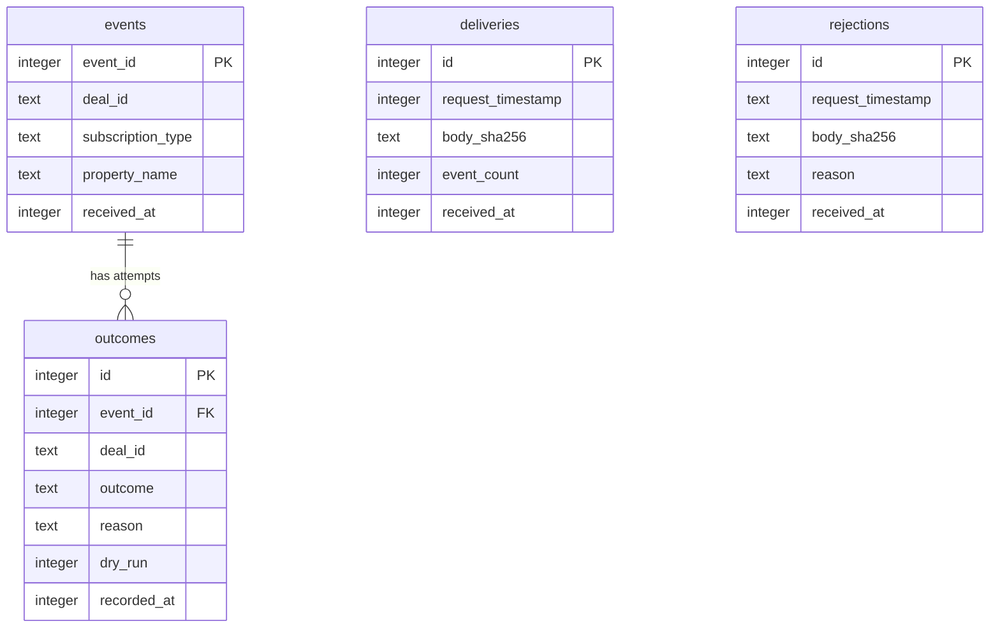

# Data model — won-deal-to-order

> **Store:** one local SQLite file, `app/schema.sql` applied at startup with `CREATE TABLE IF NOT
> EXISTS`, no migration tool ([ADR-0003](../../adr/0003-use-sqlite-file-store-with-startup-schema.md),
> architecture map §Migrations). Containers and flows: [sad.md](./sad.md) §5, §6, §8.

## Conventions (owner decisions, 2026-10-22)

- **Aggregates.** `deliveries` and `rejections` are standalone receipt logs. `events` is the
  aggregate root of a unit of work; `outcomes` belong to it (append-only, one row per attempt; the
  row with the highest `id` is the event's outcome).
- **Primary keys.** An event is keyed by the HubSpot event ID (external ID, unique, so a repeated
  delivery cannot store an event twice). Local-only rows use `INTEGER PRIMARY KEY` (SQLite rowid,
  assigned by the DB, not by the app).
- **Timestamps.** `INTEGER` epoch milliseconds, the same unit as the HubSpot timestamps kept as
  received. Only `received_at` / `recorded_at`; no `updated_at`, because no row is ever updated.
- **Constraints.** `CHECK` on the outcome values and on 0/1 flags. Foreign keys are declared;
  SQLite enforces them only with `PRAGMA foreign_keys = ON` on each connection, so `app/store.py`
  sets it on every short-lived connection.
- **Delete strategy.** None. Rows are never deleted or updated; a schema change resets the file
  (ADR-0003).
- **Personal data.** Technical IDs, counts, statuses and reasons only. No raw body,
  `propertyValue`, `sourceId`, company name, email or address anywhere (spec §6.1, sad.md §8).

## ER diagram

## Entities

### `deliveries` (standalone)

One row per accepted delivery (valid signature), written before the acknowledgement (flow 4).

| Column | Type | Constraints | Notes |
|---|---|---|---|
| `id` | INTEGER | PRIMARY KEY | rowid; the delivery ID in log lines |
| `request_timestamp` | INTEGER | NOT NULL | `X-HubSpot-Request-Timestamp`, epoch ms as received |
| `body_sha256` | TEXT | NOT NULL | hex SHA-256 of the raw body; the body itself is never stored |
| `event_count` | INTEGER | NOT NULL, CHECK (`event_count >= 0`) | events in the body; QG-2 check "event count in deliveries equals outcome count" |
| `received_at` | INTEGER | NOT NULL | epoch ms, local clock |

**Aggregate root:** root (receipt log).
**Access patterns:** insert only; `SUM(event_count)` for the QG-2 manual check (full scan, 11 rows).

### `events` (aggregate root of a unit of work)

One row per distinct event ID, inserted with `INSERT OR IGNORE`, so a repeated event keeps its
first row (flows 2 and 4, AC-12).

| Column | Type | Constraints | Notes |
|---|---|---|---|
| `event_id` | INTEGER | PRIMARY KEY | HubSpot `eventId` (a number in events); the idempotency key |
| `deal_id` | TEXT | NOT NULL | HubSpot `objectId`, kept as text (sad.md §8 IDs) |
| `subscription_type` | TEXT | NOT NULL | e.g. `deal.propertyChange`, `deal.creation` |
| `property_name` | TEXT | NULL | `dealstage` or `amount`; NULL for `deal.creation`. Tells an amount event apart (AC-12, AC-16) |
| `received_at` | INTEGER | NOT NULL | epoch ms of the first delivery that carried the event |

**Aggregate root:** root.
**Access patterns:** lookup by `event_id` (primary key). No link to `deliveries`: an event can
arrive in several deliveries, and the background task takes its event IDs from the parsed body,
not from the store.

### `outcomes` (belongs to `events`)

Append-only: one row per processing attempt. The event's outcome is its row with the highest `id`.
A final outcome (ordered, skipped or held, with `dry_run = 0`) is never followed by another row; a
`failed` or dry-run row is (flows 2 and 4; AC-13, AC-18, AC-19).

| Column | Type | Constraints | Notes |
|---|---|---|---|
| `id` | INTEGER | PRIMARY KEY | rowid; the order of attempts |
| `event_id` | INTEGER | NOT NULL, FK → `events(event_id)` | indexed below |
| `deal_id` | TEXT | NOT NULL | copied from the event, so `report` reads one table (owner decision) |
| `outcome` | TEXT | NOT NULL, CHECK IN (`ordered`, `skipped`, `held`, `failed`) | |
| `reason` | TEXT | NOT NULL | plain reason from the spec (e.g. "current stage not won", "failed: <error type>"); may carry PowerOffice technical IDs and the discount-rounding note (AC-21). Never personal values |
| `dry_run` | INTEGER | NOT NULL, CHECK IN (0, 1) | 1 = what would happen; never final (sad.md §8) |
| `recorded_at` | INTEGER | NOT NULL | epoch ms |

**Aggregate root:** `events`.
**Access patterns:** last outcome of one event → `idx_outcomes_event_id`; `report` (last outcome
per event) → the same index.
**Constraints:** FK → `events(event_id)`; CHECKs on `outcome` and `dry_run`.

### `rejections` (standalone)

One row per delivery rejected by the signature check, with its technical identity only (flow 4,
AC-15).

| Column | Type | Constraints | Notes |
|---|---|---|---|
| `id` | INTEGER | PRIMARY KEY | rowid |
| `request_timestamp` | TEXT | NULL | the timestamp header as received; NULL when missing. TEXT, because a forged delivery may send anything |
| `body_sha256` | TEXT | NOT NULL | hex SHA-256 of the raw body |
| `reason` | TEXT | NOT NULL | "signature missing" or "signature mismatch" |
| `received_at` | INTEGER | NOT NULL | epoch ms |

**Aggregate root:** root (receipt log).
**Access patterns:** insert only.

## Indexes

| Index | Columns | Query it serves |
|---|---|---|
| `idx_outcomes_event_id` | `outcomes(event_id)` | Flows 2 and 4, "reads the last outcome of the event": `SELECT ... FROM outcomes WHERE event_id = ? ORDER BY id DESC LIMIT 1` (a SQLite index includes the rowid, so the order comes from the index). Also `report`'s last outcome per event, and the FK index |

The primary keys cover the other lookups (`events.event_id` for `INSERT OR IGNORE` and the event
read). No other index has a concrete query.

## Test fixtures

Not in the schema files. Tests use `init_store(tmp_path / "store.sqlite3")` (the existing pattern in
`tests/test_store.py`) and small builder functions in the test modules, in the form implement picks:

- `make_event(event_id=1001, deal_id="1001", subscription_type="deal.propertyChange", property_name="dealstage")`: a synthetic event row.
- `make_outcome(event_id=1001, outcome="failed", reason="failed: timeout", dry_run=0)`: a synthetic outcome row.

Synthetic IDs only; no names, emails or addresses.
