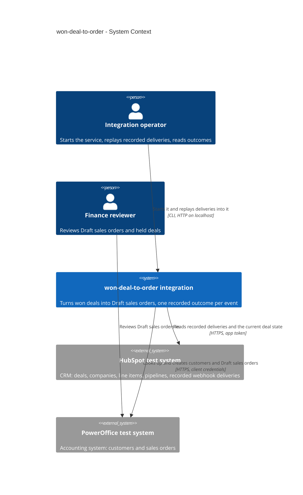
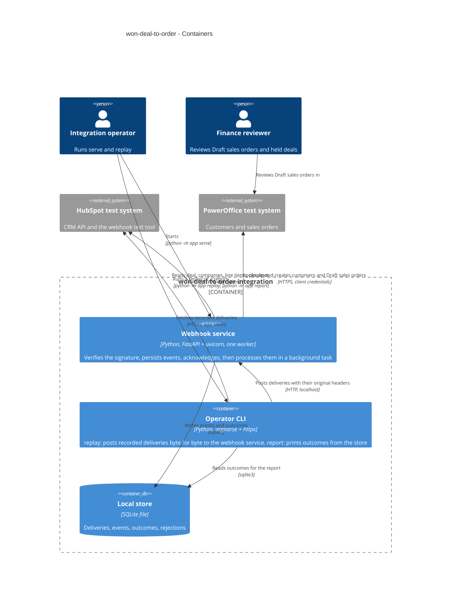
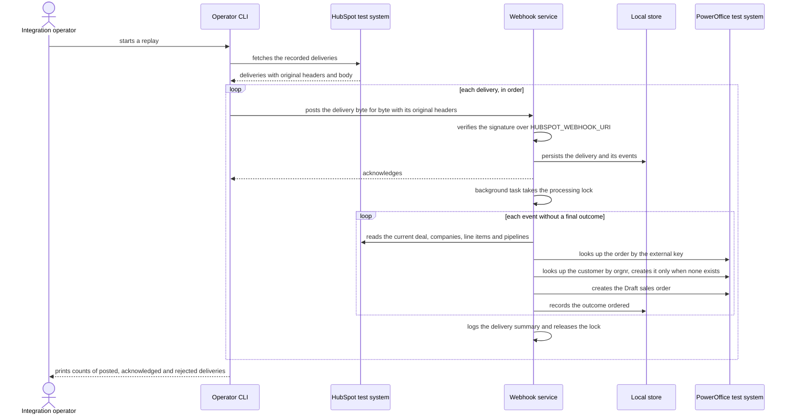
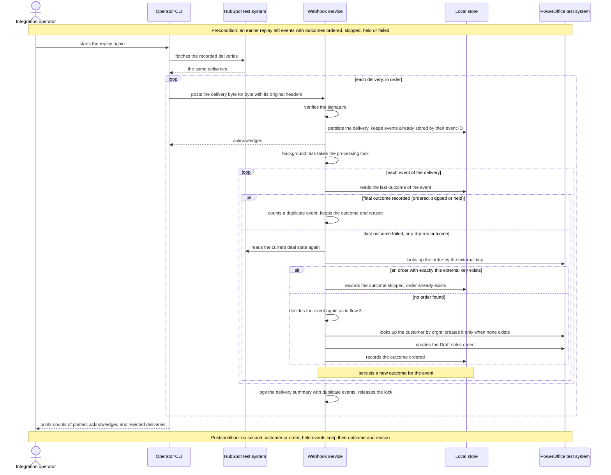
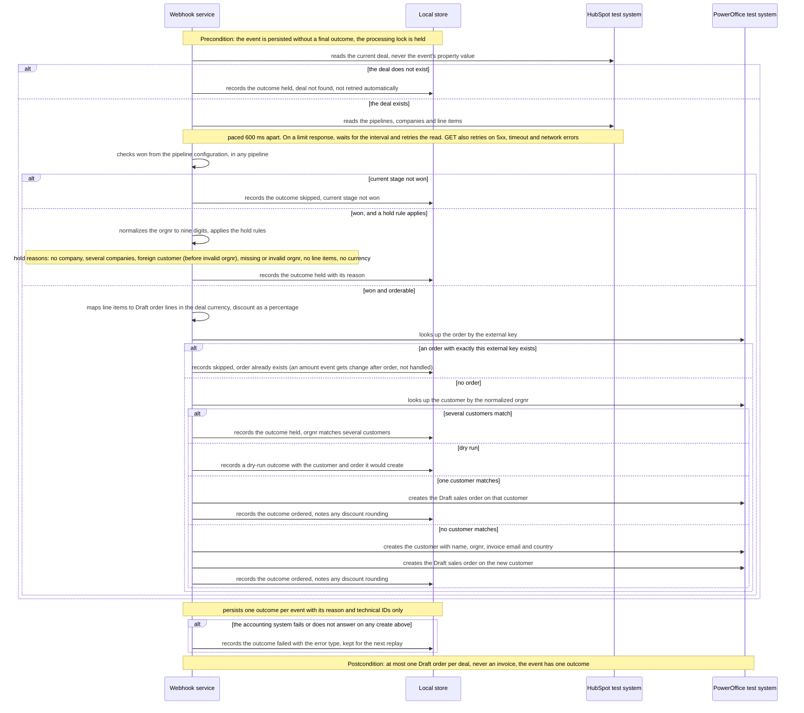
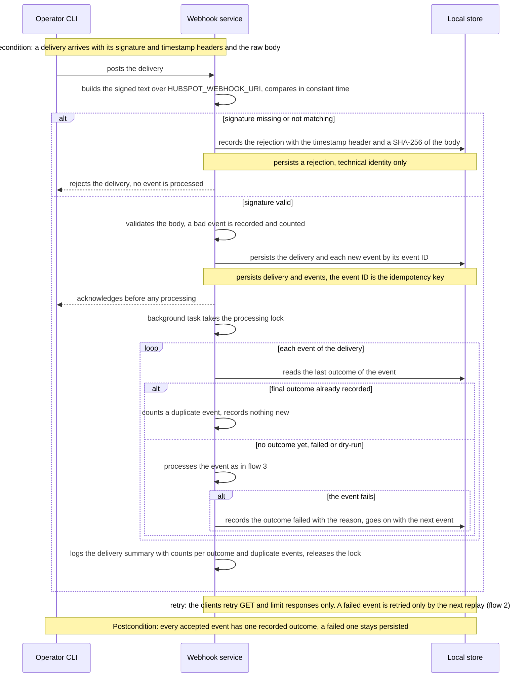

# Software Architecture Document — won-deal-to-order

> **Glossary:** [CONTEXT](./CONTEXT.md) · **Spec:** [spec.md](./spec.md) · **Foundation:**
> [architecture map](../../architecture-map.md), ADR-0001 to ADR-0003 in [docs/adr](../../adr/).
> Facts already verified in the spec (§1 traceability, §6, §6.1) are cited, not restated.

## 1. Introduction and goals

**Intent.** A local integration receives the CRM's recorded webhook deliveries. For each event it
decides from the deal's current state and records exactly one outcome: ordered, skipped, held for
review or failed. A won deal that can be decided safely becomes exactly one Draft sales order on the
right customer, with its line items, discounts and currency (spec §2). Finance reviewers get orders
without re-keying, and they see which deals were held and why.

**Top-3 quality goals (1-liners; full scenarios in §10):**

1. No duplicates: no repeated delivery, repeated event, replay or retry creates a second customer
   or order.
2. Nothing lost or decided silently: every event ends in one recorded outcome with a reason, and
   held and failed units of work stay persisted.
3. Fast acknowledgement: a delivery is acknowledged quickly, whatever the latency of the CRM or the
   accounting system.

**Stakeholders.**

| Role | Interest | Sign-off owner? |
|---|---|---|
| Finance reviewer | One correct Draft sales order per won deal; a plain reason for every held deal | No |
| Integration operator | Starts the service, replays deliveries, retries failures by a replay, reads outcomes | No |
| Sales representative | Deals won in any pipeline are picked up without extra steps (not an actor of the integration) | No |
| Tech Lead (Oleksandr Ponomarenko) | SAD approval | Yes |

<!-- Decision overrides (¶4) — populated by the critic resolution loop, empty otherwise. -->

## 2. Constraints

**Technical.**
- Python 3.14 for development and CI, `requires-python >=3.12`; FastAPI + uvicorn, httpx,
  `sqlite3`, pytest, ruff; no other dependencies ([ADR-0001](../../adr/0001-use-python-fastapi-sqlite.md)).
- Pure core, I/O at the edges, one flat package `app/` ([ADR-0002](../../adr/0002-separate-pure-core-from-io-edges.md)).
- Local SQLite file, schema applied at startup, single writer ([ADR-0003](../../adr/0003-use-sqlite-file-store-with-startup-schema.md)).
- Sync endpoints and `httpx.Client`; money is `Decimal` (architecture map, Conventions).
- pydantic models also validate CRM and accounting-system responses in `app/clients/`. pydantic is
  FastAPI's own dependency, so nothing is added to `pyproject.toml`; this extends the map's
  "boundary validation via its pydantic models" from the endpoint to the clients.

**Organisational.**
- 4-hour time box, started 2026-10-22 20:30 local time (spec §1). One developer, the owner.
- Live runs against the test systems are started only by the human (CLAUDE.md rule 7). The agent
  never calls them.

**Conventions.**
- [CLAUDE.md](../../../CLAUDE.md) engineering principles and integration checklist; architecture
  map, Conventions section.
- Check command `ruff check . && pytest`, hermetic. HTTP is faked at the client boundary with
  `httpx.MockTransport` and synthetic fixtures shaped like `evidence/`.

**Regulatory / external.**
- Only the hosts of the two test systems are called. Localhost is used for the replay.
- Personal data stays out of logs, outcomes, the store and fixtures (spec §6.1).
- No invoice is ever sent (spec §3, AC-20).

## 3. Context and scope

Sales representatives win deals in the CRM (HubSpot). Finance invoices from Draft sales orders in the
accounting system (PowerOffice). The integration sits between them. It takes the CRM's recorded
webhook deliveries, reads each deal's current state, and writes customers and Draft sales orders.

<!-- brownfield: skeleton only (scaffold commit 8e9609c): app/web.py, app/store.py, app/schema.sql, smoke and store tests; layout per docs/architecture-map.md -->

**Trust boundary.** An inbound delivery is untrusted until its signature verifies (spec §6.1,
AC-15). CRM and accounting-system responses are validated at the client boundary before the core
uses them.

**External systems (in / out):**

| Actor or system | Type | Interaction |
|---|---|---|
| Integration operator | Person | Starts the service, runs `replay`, reads outcomes with `report` and the logs |
| Finance reviewer | Person | Reviews Draft sales orders and held deals; does not use the integration directly |
| HubSpot test system | System (external) | Source of recorded deliveries (test tool) and of the current deal, companies, line items and pipelines |
| PowerOffice test system | System (external) | Customer and sales order lookup and create; token by client credentials |

**C4 Context (L1):**



## 4. Solution strategy

**Target surfaces: `backend-service` + `cli`.** The webhook service receives deliveries and
processes them. The operator CLI has two commands: `replay` feeds recorded deliveries and retries
failures, and `report` prints the recorded outcomes. Processing is a component of the service, not a separate `worker` surface.
No UI surface (spec §3). Decided in [ADR-0004](./adr/0004-process-events-in-a-background-task-and-retry-by-replay.md).

**Top strategic choices:**

1. **Acknowledge first, process in a background task, retry by replay**
   ([ADR-0004](./adr/0004-process-events-in-a-background-task-and-retry-by-replay.md)). The
   endpoint verifies the signature, persists the events and returns 2xx. Processing runs right after
   the response, under one process-wide lock. A replay of the recorded deliveries is also the retry
   for failed events. Serves quality goals 2 and 3.
2. **Decide from the current deal state with pure rules.** Each event triggers a read of the
   current deal. The won check, orgnr normalization, hold rules, order mapping and discount
   conversion are pure functions in `app/core/` that return one outcome (ADR-0002). The event's own
   property value is never trusted (AC-04). Serves quality goal 2.
3. **Two layers of idempotency.** A persisted event with a final outcome is a duplicate event
   (AC-12). Before any create, the integration looks up by an external key: the customer by orgnr,
   the order by the deal's external key, with exact equality (AC-13, spec §8). Serves quality
   goal 1.
4. **Dry run is a configuration flag.** With `DRY_RUN` on, every read and decision runs and every
   outcome is recorded, but no write reaches PowerOffice (AC-18).

## 5. Building block view

Functional core, imperative shell, in one flat package (ADR-0002). `app/core/` takes plain data and
returns decisions. `processor.py` is the shell for one unit of work: it reads through the clients,
calls the core, writes through the clients and records the outcome. The web handler and the replay
CLI are thin edges. Clients are passed into the processor as plain arguments, so tests pass fakes.

**Internal decomposition:**

```
app/
├── __main__.py          entry: `serve`, `replay` and `report` commands; wires config, store, clients
├── config.py            loads and validates env once (incl. DRY_RUN, HUBSPOT_WEBHOOK_URI)
├── web.py               webhook endpoint: raw body, signature, persist, acknowledge, schedule processing
├── processor.py         one unit of work per event, under the process-wide lock
├── replay.py            fetch recorded deliveries, post each unchanged to the local endpoint
├── report.py            read the store, print counts per outcome and one line per deal
├── store.py, schema.sql deliveries, events, outcomes, rejections
├── clients/
│   ├── hubspot.py       deal, associations, companies, line items, pipelines, recorded deliveries
│   └── poweroffice.py   token, customer search and create, sales order search and create
└── core/                pure, no I/O
    ├── signature.py     v3 signed text and constant-time comparison
    ├── orgnr.py         normalization and the foreign-registration check
    ├── won.py           won stages from pipeline metadata, any pipeline
    ├── decide.py        skip and hold rules, one outcome per event
    └── order.py         deal and line items to Draft order lines, discount as a percentage
```

**C4 Container (L2):**



## 6. Runtime view

**Critical flow 1: replay of a delivery with a won deal (happy path, AC-01, AC-17)**



### Flow 2: retry by replay (US-04, US-09; AC-12, AC-13, AC-17, AC-19)



### Flow 3: process one event (US-01, US-02, US-03, US-07, US-08; AC-01 to AC-11, AC-14, AC-18, AC-20 to AC-22)



### Flow 4: receive and acknowledge a delivery (US-04, US-05, US-06; AC-12, AC-15, AC-16)



**Flags (sequences stage):**
- Participants are named after the §5 containers and external systems, as in flow 1, instead of the
  generic vocabulary. This is an owner decision (2026-10-22) so all diagrams read the same way.
- The `report` command has no flow. It is one store read, so it adds nothing as a diagram (owner
  decision). The US-06 run summary is shown as the delivery summary log line in flow 4.
- There is no dead-letter queue. A failed event stays persisted with outcome failed and is retried
  only by the next replay (ADR-0004).

## 7. Deployment view

Not deployed (spec §3). It runs on the operator's machine as one uvicorn process with one worker,
bound to localhost, with one git-ignored SQLite file. One worker is required: the processing lock
is process-wide (ADR-0004).

**Monitoring:**
- Structured key=value log lines per delivery (ID, event count, duration, status) and per event
  (event ID, deal ID, outcome, reason). One summary line per delivery with counts per outcome and
  duplicate events.
- `python -m app report`, run after a replay: counts per outcome and one line per deal (technical
  deal ID, outcome, reason).
- No metrics backend and no alerting (spec §3 known limitations).

**Scaling thresholds:**
- Sized for the recorded test set: 11 deliveries, 13 events (`evidence/api-hubspot-webhooks.md`).
  Production needs the PostgreSQL + queue + outbox path from ADR-0003.

## 8. Crosscutting concepts

| Concept | Convention | Where defined |
|---|---|---|
| Configuration | Loaded and validated once in `config.py`; fails with missing variable names, never values. `DRY_RUN` defaults to true, so writes stay off until it is set to false (as in `.env.example` from scaffold) | CLAUDE.md; `.env.example` |
| Inbound authentication | Signature v3: HMAC over method, `HUBSPOT_WEBHOOK_URI`, raw body and timestamp, compared in constant time. Never the local URL. Timestamp age check waived (spec §6.1) | here; spec §6.1 |
| Outbound authentication | CRM: app token. Accounting system: client-credentials token, fetched once and fetched again after an authentication rejection (spec §1, §3) | here |
| Timeouts, retries, rate limit | ≤ 15 s timeout on every call. Client retries are as in the architecture map, clients row. CRM calls are paced 600 ms apart (evidence probe). On 429, honor `Retry-After` when present, else wait `X-HubSpot-RateLimit-Interval-Milliseconds`, then retry (AC-14; `Retry-After` not observed per FINDINGS) | architecture map; FINDINGS; CLAUDE.md checklist |
| Pagination | No paging fields in the evidence for the recorded deliveries (`evidence/api-hubspot-webhooks.md`) or for the PowerOffice customer and order searches (`evidence/api-poweroffice.md`), so one page is assumed. Deal association paging is a spec §3 known limitation | here; §11 |
| Run summary | One summary log line per delivery (counts per outcome and duplicate events) plus `python -m app report` after a replay: counts per outcome (ordered, skipped, held, failed) and one line per deal with technical deal ID, outcome and reason. No personal values. Duplicate events are only in the logs | here; US-06, AC-12 |
| Idempotency | Unique event ID in the store. Final outcome means duplicate event. Lookup before create: customer by normalized orgnr, order by external key `hubspot-deal-<dealId>` with exact equality | here; AC-12, AC-13 |
| Concurrency | One process-wide lock around processing; one uvicorn worker | ADR-0004 |
| Dry run | All reads and decisions run, and the outcome records what would be created. No write to PowerOffice. Dry-run outcomes are marked and never count as final, so a later real run still creates the order | here; AC-18 |
| Error handling | Config, auth or unreachable system at startup: stop with a clear message. A failure in one unit of work: outcome failed with the reason, logged with event ID, counted; the rest continue | CLAUDE.md "Errors"; AC-16 |
| Validation | Delivery body and API responses validated at the boundary (pydantic models). A bad event is recorded and counted; the others continue | CLAUDE.md checklist |
| IDs | External IDs only. Deal ID kept as text (it is a number in events, text in the CRM: spec §1) | architecture map |
| Money and rounding | `Decimal` throughout. Discount per unit becomes a percentage of the unit price, rounded half up to two decimals, and the outcome notes the rounding (AC-21) | here |
| Personal data | Not in logs, outcomes or the store. The store keeps event fields needed for processing only: no raw body, no `propertyValue`, no `sourceId`. A rejection is stored with the request timestamp header and a SHA-256 of the body | spec §6.1; AC-15 |
| Internationalisation | Currency from the deal, never assumed. Timestamps kept as received (epoch ms) | architecture map |

## 9. Architecture decisions

| # | Title | Status | Section |
|---|---|---|---|
| 0004 | Process events in a background task after the acknowledgement and retry by a replay CLI | Accepted | §4 |

ADR files live under `docs/features/won-deal-to-order/adr/NNNN-<title>.md`. Numbering continues
the repo series. The inherited foundation decisions are ADR-0001 (stack), ADR-0002 (pure core) and
ADR-0003 (SQLite store) in [docs/adr](../../adr/).

## 10. Quality requirements

**QG-1. No duplicates**
- **When:** the operator replays all recorded deliveries twice in a row, including the repeated
  event and the two deliveries of deal 40211700201.
- **Then:** duplicate orders or customers: 0 across two consecutive full replays (spec §6).
- **How verify:** hermetic tests with faked clients: a repeated event, a repeated won event for a
  deal with an order, and a failed create followed by a retry each create at most one order. Manual
  AC-17 run by the owner: replay summary plus order lookup by external key.

**QG-2. Nothing lost or decided silently**
- **When:** a replay runs, and one event fails or the CRM rate limit is hit.
- **Then:** events without a recorded outcome: 0 per replay. CRM request rate ≤ 20 requests per
  10 000 ms, per the rate-limit headers; count of limit responses that end in a lost event = 0
  (spec §6).
- **How verify:** hermetic tests for a mixed delivery (AC-16) and for a faked 429 followed by
  success (AC-14). Unit test of `report` with a temporary store. Manual run: event count in
  deliveries equals the outcome count printed by `report`.

**QG-3. Fast acknowledgement**
- **When:** a valid delivery arrives.
- **Then:** delivery acknowledgement time ≤ 5 s per delivery (the CRM retries after 5 s), target
  p95 ≤ 1 s. Timeout per external call ≤ 15 s (spec §6).
- **How verify:** endpoint test: the handler persists and schedules, and does not call the
  processor inline. Duration logged per delivery in the manual run. Client test with a stalled
  fake for the timeout. Measuring p95 is a spec known limitation.

## 11. Risks and technical debt

| Risk / debt | Severity | Mitigation | Owner |
|---|---|---|---|
| Two background tasks for the same deal (deal 40211700201 is delivered twice) both find no order and both create one | High | Process-wide lock, one uvicorn worker (ADR-0004); test with two deliveries of one deal | Oleksandr Ponomarenko |
| The order search by external key may also match partially (spec §8) | Medium | Exact equality on the returned list (owner decision); confirm in the first live run (AC-17) | Oleksandr Ponomarenko |
| A dry-run outcome is taken as final and blocks the real run | Medium | Dry-run outcomes are marked and excluded from the duplicate check (§8) | Oleksandr Ponomarenko |
| The process stops after the acknowledgement and before processing | Low | Events are persisted first; the next replay processes events without a final outcome (ADR-0004) | Oleksandr Ponomarenko |
| An order is created, but the process crashes before the outcome is recorded. A create timeout is recorded as failed (AC-13), even if the order was created | Low | The next replay finds the order by external key and records "order already exists" | Oleksandr Ponomarenko |
| A search or the recorded deliveries return more than one page | Low | No paging fields in the evidence; one page assumed (§8). Revisit if a live run shows paging fields | Oleksandr Ponomarenko |
| Discount precision and the accounting-system error format are not verified (spec §1) | Low | Rounding noted in the outcome; the error body is mapped to an error type only, never logged in full | Oleksandr Ponomarenko |

**Accepted debt (acceptable in v1, plan to fix later):**
- The spec §3 known limitations apply as listed: no automatic scheduled retries, no age check,
  minimal token refresh, no association paging, no NFR measurement, no alerting, no production
  queue. The client retries in §8 (GET and 429) are not scheduled retries.
- Reading of "run" (US-06, AC-12): a run is one replay. Its summary is the `report` output after
  the replay plus the per-delivery log lines. Duplicate events are counted in the logs only, not
  in the report.
- `report` is planned as the last task of the first milestone, so it can be dropped if time runs
  out. Without it, the run summary is the per-delivery log lines only.
- One page is assumed for the recorded deliveries and the PowerOffice searches (§8).
- The store is reset on a schema change (ADR-0003).

## 12. Glossary

Domain terms are canonical in [CONTEXT.md](./CONTEXT.md). Terms added by this design:

| Term | Meaning |
|---|---|
| Recorded delivery | A delivery kept by the CRM test tool, with its original method, address, headers and body |
| Replay | The `replay` CLI command: posts every recorded delivery unchanged to the local endpoint. It is also the retry for failed events |
| Report | The `report` CLI command: counts per outcome and one line per deal (technical deal ID, outcome, reason), read from the store |
| Final outcome | Ordered, skipped or held for review, recorded outside dry run. Failed is not final |
| Duplicate event | An event that arrives again after it already has a final outcome; counted in the delivery summary, not recorded again |
| Processing lock | The process-wide lock that lets only one background task process events at a time |
| Signed text | The text the signature covers: method, `HUBSPOT_WEBHOOK_URI`, raw body and request timestamp |
