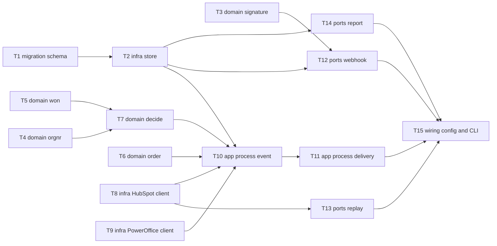

# Epic — won-deal-to-order

> **Spec:** [spec.md](../spec.md) · **Design:** [sad.md](../sad.md) · **Data model:** [data-model.md](../data-model.md) · **API:** [openapi.yaml](../contracts/openapi.yaml), [cli.md](../contracts/cli.md) · **ADRs:** [adr/](../adr/), [docs/adr](../../../adr/)

## Goal

Every won deal that can be decided safely becomes exactly one Draft sales order on the right
customer, with its line items, discounts and currency. Repeats and retries never create a second
customer or order, and every event ends in one recorded outcome with a reason (spec §2).

## Scope

- **In:** schema (`app/schema.sql`), store, pure core (`signature`, `orgnr`, `won`, `decide`, `order`), HubSpot and PowerOffice clients, processor, webhook endpoint, `replay` / `report` / `serve` commands, config. Surfaces: `backend-service`, `cli` (no `ui` layer).
- **Out:** updating or cancelling orders after later changes, matching customers by name, sending invoices, deployment, UI, re-deciding held units of work (spec §3), and the spec §3 known limitations.

## Task map

Waves: **1** T1, T3, T4, T5, T6, T8, T9 · **2** T2, T7, T13 · **3** T10, T12, T14 · **4** T11 · **5** T15.
This is one milestone (the spec's Slice 1). It is green and committed only when T15 is done.

**Timebox note (2026-10-22 23:45, deadline 00:30):** the shortest path to a runnable replay is the
critical chain T1→T2→T10→T11→T15 plus T3→T12 and T8→T13. T14 can be dropped (sad §11 accepted debt).

## Tasks

See [tracker.md](./tracker.md) for status. Machine contract: [tasks.json](../tasks.json).

| # | Task | Layer | Blocked by | DoD (short) |
|---|---|---|---|---|
| T1 | [Promote the four staged tables into app/schema.sql](./t01-schema-tables.md) | migration | — | tables + index exist after `init_store`, applies twice |
| T2 | [Add store functions](./t02-store-functions.md) | infra | T1 | store tests incl. final-outcome rule pass |
| T3 | [Verify the HubSpot v3 signature](./t03-core-signature.md) | domain | — | valid passes, any tampering fails |
| T4 | [Normalize the orgnr, detect foreign](./t04-core-orgnr.md) | domain | — | parametrized orgnr tests pass |
| T5 | [Resolve won stages from pipelines](./t05-core-won.md) | domain | — | won in any pipeline, lost/open not won |
| T6 | [Map deal to Draft order, percent discount](./t06-core-order.md) | domain | — | discount and rounding tests pass |
| T7 | [Decide skip and hold outcomes](./t07-core-decide.md) | domain | T4, T5 | one test per reason + precedence |
| T8 | [HubSpot client](./t08-hubspot-client.md) | infra | — | 429 wait, 404 not found, timeout tests pass |
| T9 | [PowerOffice client](./t09-poweroffice-client.md) | infra | — | token refresh, POST not retried, exact reference match |
| T10 | [Process one event](./t10-process-event.md) | app | T2, T6, T7, T8, T9 | one test per AC with fake clients, dry run writes nothing |
| T11 | [Process a delivery under one lock](./t11-process-delivery.md) | app | T10 | AC-16 mixed delivery, duplicates, two-thread one order |
| T12 | [Webhook endpoint](./t12-webhook-endpoint.md) | ports | T2, T3 | 204/401/400/500 tests, processing not inline |
| T13 | [Replay command](./t13-replay-command.md) | ports | T8 | byte-for-byte posting test |
| T14 | [Report command](./t14-report-command.md) | ports | T2 | report format and last-outcome counts |
| T15 | [Config and CLI wiring](./t15-config-and-cli-wiring.md) | wiring | T11, T12, T13, T14 | config errors name variables only, DRY_RUN default true |

## Risks / Hard rules

- Personal data never in logs, outcomes, the store or fixtures; outcomes carry technical IDs, counts, statuses and reasons only (spec §6.1, sad §8).
- Never send an invoice; orders are Draft only (AC-20).
- Lookup before create: customer by normalized orgnr, order by `hubspot-deal-<dealId>` with exact equality; POST never retried by the client (sad §8, architecture map clients row).
- One process-wide lock and one uvicorn worker (ADR-0004; sad §11 High risk).
- Hermetic tests only: `httpx.MockTransport` fakes, no outbound network; live runs only by the human (CLAUDE.md rule 7).
- Assumptions made in this breakdown, to confirm at review: unit price 0 with a discount → failed (T6); 429 without headers waits 10 000 ms (T8); `DRY_RUN` only off for `false` (T15).
